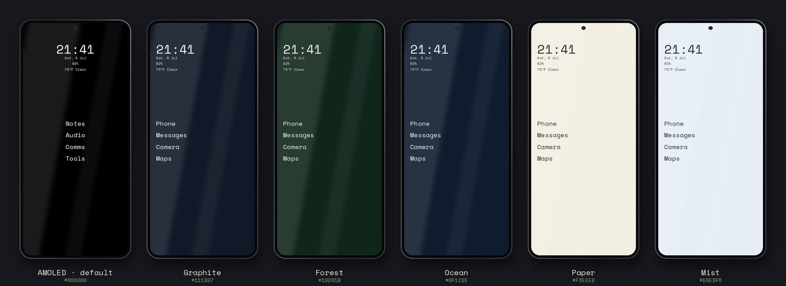

  

<h1 align="center">PiercingXX</h1>

  <b>I bend Linux to my will so you don't have to.</b> 
  Workstations, laptops, tablets, servers, phones: press the button, watch the chaos organize itself.

  <a href="#ferrite">Ferrite</a> ·
  <a href="#linux">Linux</a> ·
  <a href="#phone">Phone</a> ·
  <a href="#local-ai--self-hosting">Local AI</a> ·
  <a href="#odds--ends">Odds &amp; ends</a>

I like a simple, clean UI on a reproducible Linux ecosystem, with customizations that make sense and remove friction. Most of what's below runs on hardware I own and talks to my local-first AI for the whole house. Right now I'm building a game engine, the tools around it, and the game it exists to ship.

---

## Ferrite

**An agent-native, editor-first 3D game engine, written entirely in Rust.** Linux, Windows, and Android.

- **Agent-native.** Humans and AI agents get the same capabilities: edit, play, test, see, build. Every editor feature is also an agent tool over MCP, with undo, staged review, and an audit log. All authored data is plain text.
- **Editor-first.** Dockable editor, play-in-editor, content browser, prefabs, physically based renderer, animation graphs, code hot reload.
- **Built for deterministic sims.** Games that run their own lockstep, rollback, or server-authoritative simulation get a supported bridge, not a workaround.
- **Rust all the way down.** Engine, editor, tools, and gameplay. No scripting VM. wgpu (Vulkan / DX12), Rapier physics, Kira audio, an ECS core.

### The tools around it
Ferrite Engine Tools, private for now. Same rules as the engine: local-first, agents and humans through the same door.

- **Tincal**: a 3D asset studio built on Ferrite. Concept art to modular, rigged, game-ready assets, and everything around that.
  - **Concept:** text-to-concept, prompted edits, inpainting, turnaround and exploded-view sheets. An approved concept becomes an asset spec. No export step.
  - **Part kits, not blobs:** every asset is reusable parts with connectors, joints, sockets, damage states down to the wreck, and physics metadata, at real-world scale. Each new asset grows the part library.
  - **Library ingest:** point it at any asset library. It inventories, classifies, and batch-conforms what it finds to a faction's palette, scale, and budgets.
  - **Designer-first:** everything works by hand with AI off. A manual fix is locked so a rerun keeps it, and becomes an example the AI learns from.
  - **One command layer:** the desktop app, the CLI, the MCP server, and a voice-capable chat all call the same commands. Agents never get a capability the UI lacks.
  - Local models by default. The foundation is built; the generation pipeline is next.
- **Lodestone**: an AI-run story engine and lore keeper. Agents extract the lore, keep continuity, and draft; I review from an nvim-style cockpit and sign canon with a real key. The universe is plain YAML and Markdown.
- **Red-Rouge**: an AI director. Match records in, trailers, teasers, and Shorts out.

### The game it ships
**Direct Order 27**: hover-tank strategy and first-person combat on Europa and Mars. Hard sci-fi FPS/RTS, multiplayer only.

> In 2041 an automated alien mining ship arrived at Saturn and began stripping the solar system for an alloy nothing in nature makes. Humanity shot one hull down. Its escape pod reached Earth, hid in our infrastructure, and helped us destroy the rest. By 2161 that alloy is the most valuable thing in the solar system, there's a fixed amount of it, and the machines' masters are coming back. Four factions fight over the wrecks under Direct Order 27: collect all of it, by any means necessary.

- **Command and fight at the same time.** Pilot your own hover tank, build a base, give orders from the cockpit.
- **Four factions**, each with its own roster, history, and doctrine. Pilots fight in printed clones over a live link. Run out of clones and you're out.
- **Netcode first.** Bit-identical across operating systems, so replays are exact. 16 players by design, 32 on a dedicated host.
- **Hard science.** Every capability has a mechanism someone could explain.

In closed alpha. Steam comes after it's stable and the asset list fills out. Shipping it is Ferrite's finish line.

---

## Linux

This is the backbone. A fresh ISO becomes a daily driver here.

### Installers
- **[linux-mod](https://github.com/PiercingXX/linux-mod)**: one installer for Arch, Artix, Debian/Ubuntu, Fedora, Void, openSUSE, and Alpine. Full workstation or mini (tablets, lean boxes). Menu-driven (gum → fzf → whiptail). Resumable. Dry-run. Distro differences live inside the module, not in a pile of forks.
  - Hyprland, Sway, i3, bspwm, Awesome, Qtile, DWM, herbstluftwm, GNOME, Cosmic
  - NVIDIA + CUDA, Microsoft Surface kernel, printers, gaming extras, Docker, Tailscale
  - Variants for workstations, servers, tablets, and phones
- **[better-mac](https://github.com/PiercingXX/better-mac)**: the same idea on a fresh Mac. piercing-dots, Hyprland-style tiling, Colemak + Piercing Num.
- Per-distro trees I still keep: [Arch](https://github.com/PiercingXX/arch-mod), [Debian](https://github.com/PiercingXX/debian-mod), [FreeBSD](https://github.com/PiercingXX/freebsd-mod), plus mini for tablets ([arch-mini-mod](https://github.com/PiercingXX/arch-mini-mod), [debian-mini-mod](https://github.com/PiercingXX/debian-mini-mod)).

### Dotfiles
- **[piercing-dots](https://github.com/PiercingXX/piercing-dots)**: one repo to keep the machine updated and configured. Hyprland is the daily. The other WM configs are still in the tree.
  - Waybar, kitty, Neovim, Yazi, tmux, GIMP: minimal, fully functional powerhouses
  - `Super+/` opens the cheat sheet; `Super+S` opens a Bash-driven settings menu. Don't leave the keyboard.
  - System updates, packages, audio, Wi-Fi, Bluetooth, wallpaper, backup, users, mirrors, cleanup: all from that menu

### Device enabling
Drivers and scripts for hardware the kernel forgot, shipped with the installer:
- Surface kernel support
- NVIDIA + CUDA, assembled for a script, not a weekend
- NuVision 8" tablet Wi-Fi/Bluetooth/audio: obscure old tech that would be perfect with modern hardware
- KooTigers touchscreen/driver utilities: a neat little toy that needed some help

---

## Phone

  

The phone market is two bad options. Linux phones are a third, for different reasons: underdeveloped, buggy, and underfunded. *For now.*

- **[XX-Linux-Phone](https://github.com/PiercingXX/XX-Linux-Phone)**: a complete, minimal phone for Linux. The **XX-WM** shell plus the apps: contacts, a dialer with call screening and spam blocking, SMS/MMS, calendar, email, notes, files, clock, weather, 2FA, vitals, audiobooks, a driving screen, on-device live captions, Nearby Share (LocalSend compatible), and self-hosted Find My Device.
  - Text-first, gesture-driven, AMOLED black, Space Mono. No icon grids, anywhere.
  - Python + GTK4/libadwaita on phoc. postmarketOS, Mobian, FuriOS.
  - Maps, camera, and photos are next.

My daily is a Pixel 9 Pro on GrapheneOS running the Android versions of the same suite. **They're coming to Google Play. I'll drop the link here when they land.**

---

## Local AI & self-hosting

- **[xx-stack](https://github.com/PiercingXX/xx-stack)**: let your local AI use every computer you own. Agent contracts, routing policy, an MCP server, and a local inference control plane over Tailscale. Cloud APIs are off unless you switch them on.
- **[free-opencode-hermes](https://github.com/PiercingXX/free-opencode-hermes)**: a local proxy so OpenCode (and Hermes-Agent) can run from the terminal against providers you already have keys for, or models on machines you own. Keys stay in the proxy, not in the agent.
- **[tailscale-protonvpn-exitnode](https://github.com/PiercingXX/tailscale-protonvpn-exitnode)**: a Tailscale exit node that tunnels out through ProtonVPN. One docker-compose file.

---

## Odds & ends

- **[piercing-keyboard-layout](https://github.com/PiercingXX/piercing-keyboard-layout)**: my own layout that no one else will ever use. One layout, every platform: Linux (xkb), Windows, Android/GrapheneOS, and QMK/Vial ortho boards.
- **xx-platform** (private): ops console for the businesses under XX. Scheduling, bookkeeping, documents, reminders.
- **piercingxx-branding** (private): the brand system behind all of the above. Color, type, logomark, and voice.
- **book-list** (private): my ongoing attempt to separate the worthwhile from the well-marketed nonsense.

---

## How I work

- **Local first:** my AI, my inference, my data, my hardware. Cloud is opt-in or absent. If it can run on my hardware, it will. If it can't, buy more hardware.
- **Repeatable results:** a fresh install should feel like home in minutes. Scripts > screenshots, always. (The screenshots above are the exception that proves the rule.)
- **Text-first, gesture-driven, low-friction UX:** on a desktop, a phone, or a lock screen.
- **Elegant complexity:** hide the sharp edges, keep the power. Minimal dependencies, sane defaults, readable code, zero drama.
- **Defaults with a spine:** opinions included at no extra charge.

Yes, it's opinionated. That's why it's good.

**Stack**
- Rust for the engine and the game
- Kotlin + Jetpack Compose on Android; Python + GTK4/libadwaita on Linux phones
- FastAPI for house servers, Go when the binary *is* the product
- Bash. It's a love language; put it everywhere you can
- Python when you have to
- kitty, Yazi, Neovim. tmux is a must
- Docker/Compose, NVIDIA + CUDA, SGLang, Wyoming/Home Assistant, Tailscale

---

## Contact

Email: don't.

Open an issue in the relevant repo. If it's a rant, make it entertaining.
